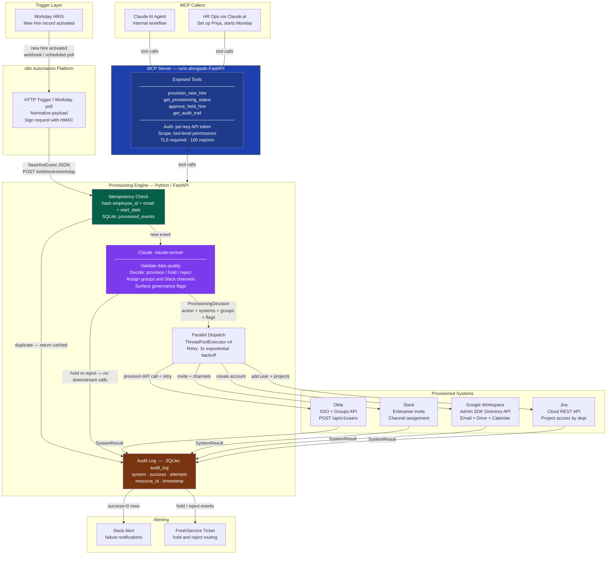

# Architecture Diagram — HeliosHR Onboarding Automation

## System Overview (Mermaid)

## MCP Server — Tool Definitions

| Tool | Parameters | Scope required | What it does |
|---|---|---|---|
| `provision_new_hire` | employee_id, full_name, email, department, title, manager_email, start_date, location | `it_ops` | Triggers the full provisioning pipeline |
| `get_provisioning_status` | employee_id | `it_ops` · `hr_ops` · `claude_agent` | Returns current decision + per-system result |
| `approve_held_hire` | employee_id, approver_email | `it_ops` · `hr_ops` | Releases a held hire into provisioning |
| `get_audit_trail` | employee_id | `it_ops` · `hr_ops` · `claude_agent` | Full audit log for a hire |

**Security model:** Every MCP caller authenticates with an API key. Each key carries a scope list (`it_ops`, `hr_ops`, `claude_agent`). Tools check scope before executing. All traffic requires TLS. Rate limit: 100 req/min per key.

## Data Flow Summary

| Step | From | To | Data |
|---|---|---|---|
| 1 | Workday | n8n | New hire activation event |
| 2 | n8n | Provisioning Engine | Normalized `NewHireEvent` JSON |
| 3 | Engine | SQLite | Idempotency hash check |
| 4 | Engine | Claude | NewHireEvent for assessment |
| 5 | Claude | Engine | `ProvisioningDecision` (action, systems, groups, flags) |
| 6 | Engine x4 | Okta / Slack / GWS / Jira | Provisioning API calls |
| 7 | Each system | Engine | Success/failure + resource ID |
| 8 | Engine | SQLite audit_log | Per-system result |
| 9 | Engine | Slack / FreshService | Failure alert or hold ticket |

## Key Integration Points

- **Workday → n8n**: Workday Studio custom report trigger or REST API polling (n8n HTTP Request node on a schedule)
- **n8n → Engine**: HTTP POST to `/webhooks/workday`; n8n holds the Workday credential and signs the request with an HMAC header
- **Engine → Claude**: Anthropic Messages API; system prompt encodes governance rules
- **Engine → Okta**: Okta Users API (`POST /api/v1/users?activate=true`) + Groups API
- **Engine → Slack**: `users.admin.invite` (Enterprise Grid) or invite via email
- **Engine → Google Workspace**: Admin SDK Directory API (`POST /admin/directory/v1/users`)
- **Engine → Jira**: Jira Cloud REST API (`POST /rest/api/3/user`)
- **MCP → Engine**: FastAPI routes exposed as MCP tools; authenticated with per-key scopes
